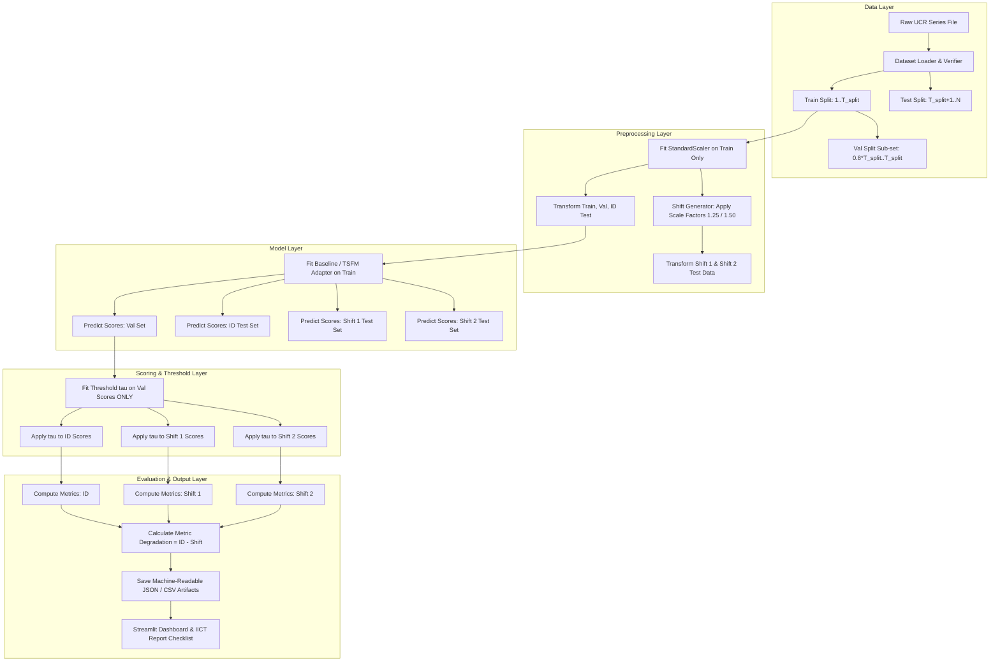

# SYSTEM_ARCHITECTURE.md: Modular System Architecture & Repository Layout

## 1. Architectural Overview & Component Responsibilities

The CA-4 software system is organized into 12 decoupled, modular components designed to support reproducible experimentation, baseline independence, and interactive dashboard exploration.

```
┌─────────────────────────────────────────────────────────────────────────────────┐
│                              SYSTEM ARCHITECTURE                                │
└─────────────────────────────────────────────────────────────────────────────────┘

 ┌───────────────────────┐    ┌───────────────────────┐    ┌───────────────────────┐
 │  1. Dataset Loader &  │───>│  2. Data Profiler &   │───>│   3. Preprocessing &  │
 │     Validation        │    │     Visualizer        │    │    Window Engine      │
 └───────────────────────┘    └───────────────────────┘    └───────────────────────┘
                                                                       │
                                                                       ▼
 ┌───────────────────────┐    ┌───────────────────────┐    ┌───────────────────────┐
 │ 7. Controlled Shift   │<───│  6. Anomaly Scoring & │<───│  4. Baseline & 5. TSFM│
 │    Generator          │    │     Timestamp Align   │    │     Model Adapters    │
 └───────────────────────┘    └───────────────────────┘    └───────────────────────┘
             │                                                         │
             ▼                                                         ▼
 ┌───────────────────────┐    ┌───────────────────────┐    ┌───────────────────────┐
 │ 8. Threshold Selector │───>│ 9. Evaluator &        │───>│ 10. Persistence &     │
 │    (Validation-Only)  │    │    Robustness Engine  │    │     Run Registry      │
 └───────────────────────┘    └───────────────────────┘    └───────────────────────┘
                                                                       │
                                                                       ▼
                              ┌───────────────────────┐    ┌───────────────────────┐
                              │ 11. Streamlit Interactive│  │ 12. IICT Report       │
                              │     Dashboard         │    │     Evidence Generator│
                              └───────────────────────┘    └───────────────────────┘
```

### Component Responsibility Breakdown

1. **Dataset Acquisition & Validation (`src/data/loader.py`):** Downloads, parses UCR filename syntax, splits training/test sets, and executes the 8-point data quality checklist.
2. **Data Profiling & Visualization (`src/data/profiler.py`):** Calculates summary statistics (mean, std, skew, kurtosis) and plots labeled time series.
3. **Preprocessing & Window Generation (`src/preprocessing/windowing.py`):** Fits training scalers, constructs sliding windows ($W=100, S=1$), and ensures timestamp index alignment.
4. **Conventional Baseline Models (`src/models/baselines/`):** Implements `IsolationForestDetector` and `LSTMAutoencoderDetector`.
5. **TSFM Model Adapter (`src/models/tsfm/`):** Implements `MomentDetector` and `ChronosDetector` adhering to the common detector interface.
6. **Anomaly Scoring & Alignment (`src/scoring/aligner.py`):** Converts model outputs (reconstruction error, forecasting error, path length) into aligned point-wise continuous score vectors.
7. **Controlled Distribution-Shift Generator (`src/shifts/amplitude_shift.py`):** Generates Shift 1 ($a=1.25$) and Shift 2 ($a=1.50$) test series without modifying anomaly ground-truth labels.
8. **Threshold Selector (`src/scoring/threshold.py`):** Fits decision thresholds $\tau$ strictly on validation split scores $s(t \in D_{\text{val}})$.
9. **Evaluator & Robustness Analysis (`src/evaluation/metrics.py`):** Computes Precision, Recall, F1, PR-AUC, ROC-AUC, and metric degradation between ID and shifted test sets.
10. **Experiment Persistence (`src/utils/persistence.py`):** Saves full experiment run configs, thresholds, predictions, metrics, and environment details as deterministic JSON/CSV artifacts.
11. **Interactive Dashboard (`app.py`):** Streamlit application presenting dataset profiling, model execution, interactive anomaly score plots, and comparative performance tables.
12. **Report Evidence Generator (`src/utils/report_generator.py`):** Formats saved metrics and visualizations directly into tables and charts formatted for the IICT report template.

---

## 2. Common Detector Interface Contract

All models (baselines and TSFM adapters) MUST implement the standard object-oriented interface defined in `src/models/base.py`:

```python
from abc import ABC, abstractmethod
import numpy as np

class BaseAnomalyDetector(ABC):
    """Abstract Base Class for all Time-Series Anomaly Detectors."""

    def __init__(self, model_id: str, config: dict):
        self.model_id = model_id
        self.config = config
        self.is_fitted = False

    @abstractmethod
    def fit(self, X_train: np.ndarray) -> "BaseAnomalyDetector":
        """Fit the model on normal training data sequence or windows.
        
        Args:
            X_train: Normal training sequence or window array.
        """
        pass

    @abstractmethod
    def predict_score(self, X_test: np.ndarray) -> np.ndarray:
        """Compute un-thresholded continuous anomaly scores for test data.
        
        Args:
            X_test: Test sequence or window array.
            
        Returns:
            1D numpy array of float64 anomaly scores (higher score = more anomalous).
        """
        pass
```

---

## 3. Data Flow Pipeline Diagram (Mermaid)



---

## 4. Proposed Repository Directory Structure

```
tsfm-anomaly-shift/
│
├── configs/                        # Configuration files (YAML / JSON)
│   ├── default_config.json         # Master experiment configuration
│   └── dataset_registry.json       # Metadata registry of verified UCR series
│
├── docs/                           # Documentation artifacts
│   ├── PROJECT_SPEC.md
│   ├── EXPERIMENT_PROTOCOL.md
│   ├── DATASET_CARD_TEMPLATE.md
│   ├── MODEL_FEASIBILITY.md
│   ├── SYSTEM_ARCHITECTURE.md
│   ├── IMPLEMENTATION_ROADMAP.md
│   ├── REPORT_EVIDENCE.md
│   ├── PROJECT_STATUS.md
│   └── DECISIONS.md
│
├── src/                            # Main source code directory
│   ├── __init__.py
│   ├── data/                       # Data loading and verification
│   │   ├── __init__.py
│   │   ├── loader.py
│   │   └── profiler.py
│   │
│   ├── preprocessing/              # Scalers and windowing engines
│   │   ├── __init__.py
│   │   ├── scaler.py
│   │   └── windowing.py
│   │
│   ├── models/                     # Anomaly detector implementations
│   │   ├── __init__.py
│   │   ├── base.py                 # Abstract Base Class detector interface
│   │   ├── baselines/
│   │   │   ├── __init__.py
│   │   │   ├── isolation_forest.py
│   │   │   └── lstm_ae.py
│   │   └── tsfm/
│   │       ├── __init__.py
│   │       ├── moment_adapter.py
│   │       └── chronos_adapter.py
│   │
│   ├── shifts/                     # Controlled distribution shift generation
│   │   ├── __init__.py
│   │   └── amplitude_shift.py
│   │
│   ├── scoring/                    # Score alignment and thresholding
│   │   ├── __init__.py
│   │   ├── aligner.py
│   │   └── threshold.py
│   │
│   ├── evaluation/                 # Metrics & degradation engine
│   │   ├── __init__.py
│   │   └── metrics.py
│   │
│   └── utils/                      # Persistence, logging, report helpers
│       ├── __init__.py
│       ├── logger.py
│       ├── persistence.py
│       └── report_generator.py
│
├── tests/                          # Automated unit & integration tests
│   ├── test_data_loader.py
│   ├── test_windowing.py
│   ├── test_baseline_smoke.py
│   ├── test_tsfm_smoke.py
│   ├── test_shifts.py
│   └── test_metrics.py
│
├── experiments/                    # Execution entrypoints & notebooks
│   ├── run_experiment.py           # Main CLI experiment runner
│   └── colab_demo.ipynb            # Google Colab execution notebook
│
├── results/                        # Saved experiment JSON outputs & plots
│   ├── json/                       # Machine-readable experiment records
│   └── plots/                      # High-resolution output figures
│
├── app.py                          # Streamlit Interactive Dashboard entrypoint
├── requirements.txt                # Pinned dependency requirements
├── .gitignore                      # Git ignore file (excludes data, checkpoints, venv)
└── README.md                       # Comprehensive GitHub repository guide
```

---

## 5. Experiment Result JSON Persistence Schema

Every execution run produces a standardized JSON record saved in `results/json/{run_id}.json`:

```json
{
  "run_id": "RUN_20261010_001_IFOREST_ID_SHIFT",
  "timestamp": "2026-10-10T22:45:00",
  "environment": {
    "python_version": "3.10.12",
    "pytorch_version": "2.1.0",
    "device": "cpu"
  },
  "experiment_config": {
    "dataset_id": "001_UCR_Anomaly_DISTORTED1k",
    "model_id": "isolation_forest",
    "window_size": 100,
    "stride": 1,
    "random_seed": 42,
    "threshold_method": "val_99_percentile"
  },
  "threshold_val": 0.84521,
  "metrics": {
    "in_distribution": {
      "precision": 0.852,
      "recall": 0.910,
      "f1": 0.880,
      "pr_auc": 0.895,
      "roc_auc": 0.962
    },
    "shift_1_scale_1_25": {
      "precision": 0.720,
      "recall": 0.850,
      "f1": 0.780,
      "pr_auc": 0.792,
      "roc_auc": 0.891
    },
    "shift_2_scale_1_50": {
      "precision": 0.580,
      "recall": 0.720,
      "f1": 0.642,
      "pr_auc": 0.630,
      "roc_auc": 0.785
    }
  },
  "degradation": {
    "shift_1_scale_1_25": {
      "f1_degradation": 0.100,
      "pr_auc_degradation": 0.103,
      "roc_auc_degradation": 0.071
    },
    "shift_2_scale_1_50": {
      "f1_degradation": 0.238,
      "pr_auc_degradation": 0.265,
      "roc_auc_degradation": 0.177
    }
  }
}
```
